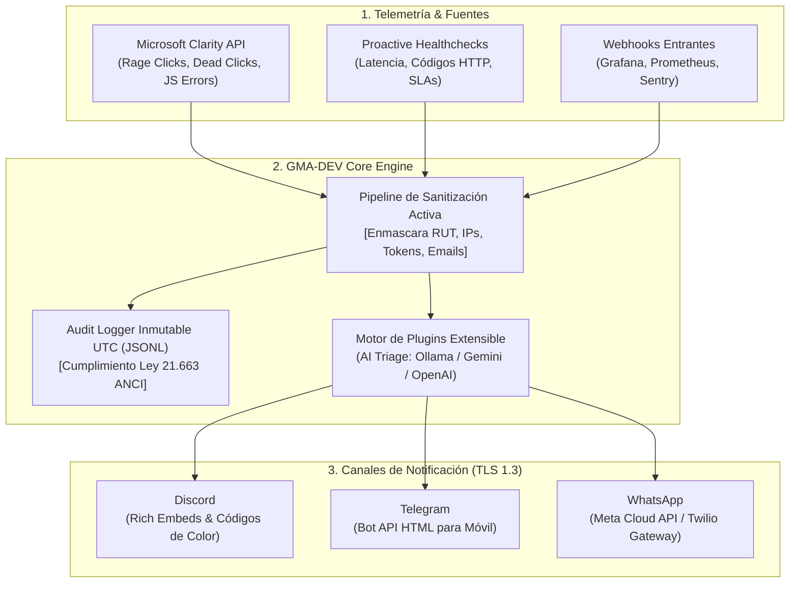

# GMA-DEV (Get My Alert, Developer)

> **Enterprise-grade, privacy-first ChatOps & Incident Monitoring System.**  
> Diseñado para SysAdmins, DevOps y equipos de desarrollo que gestionan servicios web de misión crítica, unificando telemetría técnica, analítica UX de Microsoft Clarity y despacho multicanal en **Discord**, **Telegram** y **WhatsApp**.

[](LICENSE)
[](SECURITY.md)
[](Dockerfile)
[](infra/terraform/)
[](.github/workflows/ci.yml)

---

## 🎯 ¿Qué es GMA-DEV y qué problema resuelve?

En la gestión de servicios web modernos (e-commerce, SaaS, APIs y portales corporativos), los equipos suelen enfrentarse a tres problemas críticos:

1. **Monitoreo fragmentado y ciego al usuario:** Las herramientas tradicionales de uptime solo verifican si el servidor devuelve HTTP 200, pero no detectan si el frontend está inutilizable (botones rotos, pasarelas de pago colgadas o errores de scripts de cliente). GMA-DEV conecta **Microsoft Clarity** con el monitoreo de infraestructura para alertar cuando los usuarios sufren *rage clicks* o bloqueos en la interfaz.
2. **Riesgo legal y fuga de PII en mensajería:** Enviar trazas de error sin filtrar a canales de chat de terceros (Discord, Telegram, WhatsApp) viola directamente las leyes de protección de datos personales (GDPR y la Nueva Ley de Protección de Datos en Chile) y los marcos de ciberseguridad (Ley Nº 21.663). GMA-DEV incluye un **motor mandatorio de sanitización** que enmascara RUTs, correos, IPs públicas y credenciales antes de que salgan a internet.
3. **Contradicción entre ChatOps y Denuncias ANCI/CSIRT:** La Ley 21.663 exige entregar a la autoridad la IP origen real, vectores y evidencia técnica de un ataque dentro de plazos estrictos (3 a 72 horas), pero divulgar esa IP en Discord o Telegram viola la privacidad. GMA-DEV implementa una **Bóveda Forense Local y Generador de Expediente ANCI (`/anci-dossier`)**: el chat recibe un puntero seguro con la IP enmascarada, mientras la bóveda inmutable conserva la IP real del atacante, hashes SHA-256 y enlaces a grabaciones de Microsoft Clarity listos para la notificación oficial.
4. **Punto único de fallo en la observabilidad:** Si la herramienta de alertas depende de un solo proveedor o cae Cloudflare/DNS, el equipo queda a ciegas. GMA-DEV está preparado para ejecutarse de forma **híbrida y redundante** (local en Docker y en nubes como GCP, AWS o Azure con Terraform).

---

## 🏗️ Arquitectura General



---

## 📚 Índice de Documentación Detallada

Para facilitar la adopción e implementación en cualquier entorno, la documentación completa se divide en guías especializadas:

| Área | Documento | Descripción |
| :--- | :--- | :--- |
| **Configuración de Canales** | [Guía de Canales de Chat](docs/setup/channels.md) | Paso a paso desde cero para crear el bot de Telegram (@BotFather), Webhooks de Discord y la API de Meta para WhatsApp. |
| **Fuentes de Telemetría** | [Telemetría & Microsoft Clarity](docs/setup/telemetry-clarity.md) | Cómo obtener las claves de Microsoft Clarity, umbrales de UX y monitoreo HTTP proactivo. |
| **Despliegue Local** | [Despliegue Local con Docker](docs/setup/deployment-local-docker.md) | Configuración con Docker Compose, variables de entorno y perfil de IA local. |
| **Google Cloud (GCP)** | [Despliegue en GCP con Terraform](docs/cloud/gcp-terraform.md) | Despliegue en Google Cloud Run v2 (Santiago `southamerica-west1`), Secret Manager y Cloud Scheduler. |
| **Amazon Web Services (AWS)** | [Despliegue en AWS con Terraform](docs/cloud/aws-deployment.md) | Despliegue en AWS ECS Fargate con Secrets Manager y roles IAM de mínimo privilegio. |
| **Microsoft Azure** | [Despliegue en Azure](docs/cloud/azure-deployment.md) | Despliegue en Azure Container Apps con Log Analytics y variables protegidas. |
| **Extensibilidad & IA** | [Plugins & Enriquecimiento IA](docs/extensibility/plugins-and-ai.md) | Creación de plugins personalizados e integración con Ollama (offline), Gemini o OpenAI. |
| **Dossiers Oficiales & Reportes** | [Expedientes ANCI & Post-Mortems (PDF/MD)](dossiers/) | Plantillas y ejemplos generados en PDF/MD para notificación formal a ANCI/CSIRT (Ley 21.663), RCA de caídas y reportes de Clarity. |
| **Marco Legal & Seguridad** | [Seguridad y Cumplimiento Normativo](SECURITY.md) | Detalle de cumplimiento con Ley 21.663, Ley 21.459 y estándares GDPR. |

---

## ⚡ Inicio Rápido en 3 Pasos (Docker)

### 1. Clonar el repositorio
```bash
git clone https://github.com/DnRT/GMA-DEV.git
cd GMA-DEV
```

### 2. Configurar variables de entorno
```bash
cp .env.example .env
```
Edita `.env` con las credenciales de los canales que desees activar (revisa la [Guía de Canales](docs/setup/channels.md)).

### 3. Levantar el servicio
```bash
# Modo estándar:
docker compose up -d --build

# Modo con Inteligencia Artificial Local (Ollama):
docker compose --profile ai up -d --build
```

El servicio iniciará los monitores programados y expondrá la API de webhooks en `http://localhost:8080/healthz`.

---

## ⚖️ Licencia
Distribuido bajo la **Licencia MIT**. Consulta el archivo [`LICENSE`](LICENSE) para más detalles.  
Copyright (c) 2026 Eugenio Cortés.
