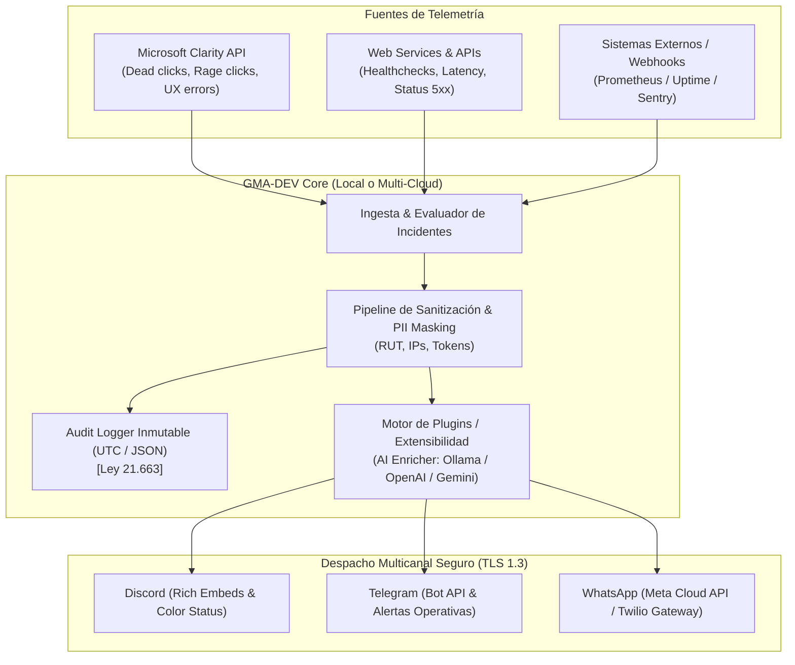

# GMA-DEV (Get My Alert, Developer)

> **Enterprise-grade, privacy-first ChatOps & Incident Monitoring System.**  
> Built for SysAdmins and DevOps teams managing mission-critical web services with automated notifications via **Discord**, **Telegram**, and **WhatsApp**.

[](LICENSE)
[](SECURITY.md)
[](Dockerfile)
[](infra/terraform/)

---

## 🏛️ Visión General & Cumplimiento Normativo (Chile & Global)

**GMA-DEV** (*Get My Alert, Developer*) está diseñado bajo el principio estricto de **Seguridad por Defecto y por Diseño (*Security by Design*)**, cumpliendo de forma nativa con los marcos legales vigentes y proyectados:

1. **Ley Marco de Ciberseguridad (Ley Nº 21.663 - Chile):**
   - **Trazabilidad inmutable:** Registro local de auditoría en formato JSON con marcas de tiempo en UTC (`ISO 8601`) para reportes ante la ANCI y CSIRT.
   - **Principio de Mínimo Privilegio:** Ejecución sin privilegios de `root` en contenedores y control estricto de llamadas API.
2. **Ley sobre Delitos Informáticos (Ley Nº 21.459 - Chile / Convenio de Budapest):**
   - Telemetría legítima y no invasiva de endpoints autorizados.
   - Prevención de abuso de dispositivos e inyección de comandos.
3. **Nueva Ley de Protección de Datos Personales (Chile) y GDPR (UE):**
   - **Pipeline de Sanitización Activa:** Enmascara automáticamente antes de notificar:
     - RUT chileno (`XX.XXX.XXX-X`)
     - Correos electrónicos y tarjetas de crédito
     - Tokens de sesión, JWT, Authorization Bearer, Passwords y API Keys
     - Direcciones IP públicas de usuarios finales
   - **Alerta por Puntero (Pointer Alerts):** Solo se despachan resúmenes técnicos abstractos a plataformas de terceros (Discord, Telegram, WhatsApp), evitando la fuga transfronteriza de datos personales.

---

## 🏗️ Arquitectura del Sistema



---

## 🚀 Despliegue Multi-Cloud & Resiliencia

GMA-DEV soporta despliegue redundante e híbrido para evitar caídas ante fallos de proveedores de DNS o Cloudflare:

| Entorno | Método de Despliegue | Ubicación de Configuración |
| :--- | :--- | :--- |
| **Local / Bare Metal** | Docker & Docker Compose | [`docker-compose.yml`](docker-compose.yml) |
| **GCP (Google Cloud)** | Terraform (Cloud Run + Secret Manager) | [`infra/terraform/gcp/`](infra/terraform/gcp/) |
| **AWS** | Terraform (ECS Fargate + Secrets Manager) | [`infra/terraform/aws/`](infra/terraform/aws/) |
| **Azure** | Terraform (Container Apps + Key Vault) | [`infra/terraform/azure/`](infra/terraform/azure/) |

---

## ⚡ Inicio Rápido (Docker Local)

### 1. Clonar y configurar variables de entorno
```bash
git clone https://github.com/DnRT/GMA-DEV.git
cd GMA-DEV
cp .env.example .env
```

Edita `.env` con tus tokens de Discord, Telegram, WhatsApp y Clarity.

### 2. Levantar con Docker Compose
```bash
docker compose up -d --build
```

El servicio iniciará los monitores programados y expondrá la API de webhooks en `http://localhost:8080`.

---

## 🧩 Plugins & Extensibilidad con Inteligencia Artificial

GMA-DEV incluye un plugin modular de enriquecimiento con IA (`AIEnricherPlugin`):
* **Ollama (100% Local y Offline):** Analiza logs y anomalías sin enviar datos fuera de tu red privada.
* **Google Gemini / OpenAI:** Opcional para generar resúmenes ejecutivos matutinos del estado de salud web.

---

## 📜 Licencia y Seguridad
* Licencia: [MIT](LICENSE)
* Políticas de seguridad y cumplimiento legal: [SECURITY.md](SECURITY.md)
