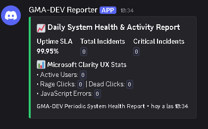
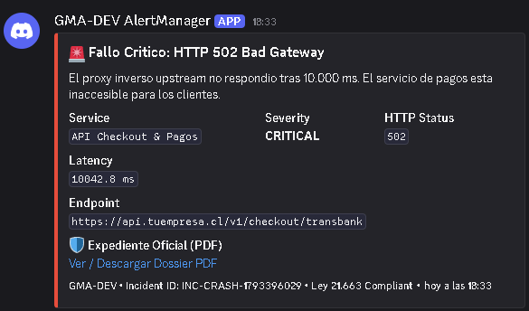
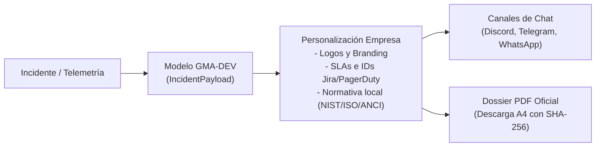
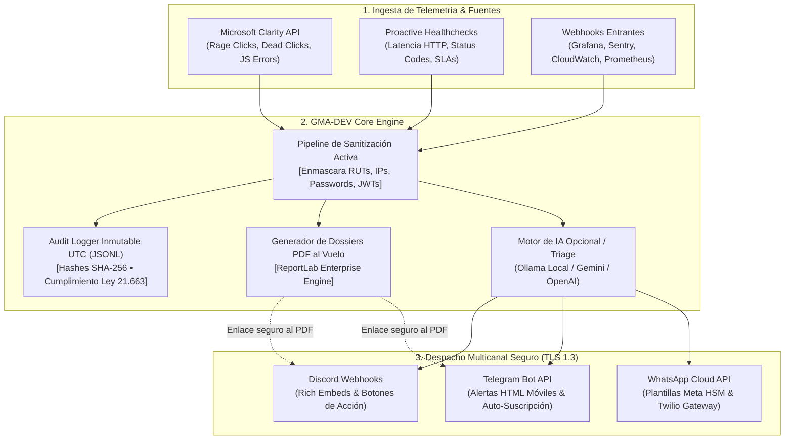

<div align="center">

# 🛡️ GMA-DEV (Get My Alert, Developer)
### Enterprise ChatOps, Observabilidad UX & Automatización de Expedientes de Incidentes

[](LICENSE)
[-blue.svg)](SECURITY.md)
[](https://www.python.org/)
[](https://fastapi.tiangolo.com/)
[](Dockerfile)
[-7B42BC?logo=terraform&logoColor=white)](infra/terraform/)
[](docs/setup/telemetry-clarity.md)

<p align="center">
  <strong>GMA-DEV</strong> es una herramienta backend y headless de observabilidad y respuesta a incidentes diseñada para SysAdmins, DevOps y Tech Leads. Al no requerir un frontend propietario, centraliza la interacción donde el equipo ya opera: despacho multicanal seguro en <strong>Discord</strong>, <strong>Telegram</strong> y <strong>WhatsApp</strong>, ingesta de telemetría UX en tiempo real con <strong>Microsoft Clarity</strong>, sanitización mandatoria de datos personales (PII) y generación al vuelo de <strong>Expedientes Técnicos y Dossiers en PDF</strong> listos para auditorías o notificación a autoridades (Ley Nº 21.663 / ANCI / CSIRT).
</p>

</div>

---

## 📸 Demostración Visual en Producción

Las alertas en canales de mensajería están optimizadas para lectura inmediata por el equipo on-call, con código de colores según severidad y enlaces directos a la bóveda de expedientes:

<p align="center">
  
  &nbsp;
  
</p>

<p align="center">
  <em><strong>Izquierda:</strong> Reporte periódico de actividad y métricas de experiencia de usuario (SLA 99.95%, Rage Clicks, Dead Clicks).<br/>
  <strong>Derecha:</strong> Alerta de incidente crítico (HTTP 502) con latencia exacta, servicio afectado y botón de descarga directa del Dossier PDF oficial.</em>
</p>

---

## 🎯 ¿Por qué GMA-DEV? Los 4 Desafíos que Resuelve

1. **La paradoja de las alertas "HTTP 200 OK" (Ceguera de Frontend):**  
   Una infraestructura puede reportar 100% de disponibilidad en el backend mientras los usuarios experimentan pasarelas de pago congeladas, botones de checkout rotos o scripts bloqueados. GMA-DEV ingesta métricas de **Microsoft Clarity** en tiempo real (*Rage Clicks*, *Dead Clicks* y errores de JavaScript), alertando a los desarrolladores antes de que los clientes abandonen la plataforma.
2. **Fuga inadvertida de PII y Riesgo Legal (Ley 21.663 & Protección de Datos):**  
   Enviar volcados de pila (stack traces), logs con correos, RUTs chilenos o credenciales de conexión directamente a canales de mensajería de terceros (Discord, Telegram, WhatsApp) es una infracción legal grave. GMA-DEV procesa todo evento a través de un **pipeline de sanitización activa** que ofusca tokens, RUTs, correos e IPs públicas antes del despacho externo.
3. **El conflicto entre ChatOps y Denuncias a la Autoridad (ANCI / CSIRT):**  
   Bajo normativas de ciberseguridad modernas (como la **Ley 21.663 en Chile** o GDPR en Europa), las organizaciones deben conservar la evidencia forense completa (IP de origen real, vectores y trazas) y notificar incidentes en plazos estrictos (3 a 72 horas). GMA-DEV resuelve este dilema mediante el **Patrón Puntero Seguro**: el chat recibe solo la alerta sanitizada, mientras la API genera al vuelo un **Dossier Técnico A4 en PDF** con hash SHA-256, disponible únicamente mediante autenticación o red privada.
4. **Resiliencia Multi-Cloud sin ataduras (Zero Vendor Lock-in):**  
   Preparado para correr en local mediante Docker o desplegarse de manera distribuida y serverless en **Google Cloud (Cloud Run Santiago `southamerica-west1`)**, **AWS (ECS Fargate)** o **Microsoft Azure (Container Apps)** mediante plantillas de Terraform listas para producción.

---

## 🧩 Plantillas de Incidentes & Personalización Modular (Licencia MIT)

> [!IMPORTANT]  
> **Arquitectura basada en plantillas:** Los tipos de incidentes, reportes periódicos y expedientes PDF incluidos en GMA-DEV son **plantillas base extensibles**. Gracias a su **Licencia MIT**, cualquier organización o empresa puede clonar este repositorio y adaptarlo a su propia infraestructura sin costo de licencias.



### ¿Qué puede personalizar tu empresa?
- **Catálogo de Severidades y SLAs:** Define tiempos de respuesta, códigos de color y menciones de roles específicos (ej. `@on-call-devops`, `@ciso`) en `src/integrations/channels/`.
- **Dossiers Técnicos y Formato Legal:** Ajusta las plantillas de `dossiers/` y el generador de PDF (`src/core/reporting/pdf_generator.py`) para incluir el logo corporativo de tu empresa, los términos de tu marco legal o anexar enlaces a tickets internos (Jira, ServiceNow, Linear).
- **Conectores y Pasarelas Propias:** Agrega monitores para pasarelas de pago regionales (Transbank, Webpay, MercadoPago), ERPs internos o sistemas legados mediante endpoints FastAPI sencillos.
- **Canales de Notificación Dinámicos:** Configuración flexible sin "hardcodear" IDs de chat; soporte para auto-descubrimiento en Telegram y registro dinámico de números vía API.

---

## 🏗️ Arquitectura del Sistema



---

## ⚡ Inicio Rápido (3 Minutos)

### 1. Clonar el repositorio
```bash
git clone https://github.com/DnRT/GMA-DEV.git
cd GMA-DEV
```

### 2. Configurar variables de entorno
```bash
cp .env.example .env
```
Edita `.env` e introduce tus credenciales (por ejemplo, el Webhook de Discord para pruebas inmediatas). Consulta la [Guía de Canales de Chat](docs/setup/channels.md) para el paso a paso.

### 3. Levantar con Docker Compose
```bash
docker compose up -d --build
```
El contenedor se iniciará bajo un usuario no-root (`appuser`), corriendo en `http://localhost:8080`.  
Verifica la salud del servicio:
```bash
curl http://localhost:8080/healthz
```

---

## 🧪 Simulador de Incidentes (Pruebas sin Caídas de Producción)

GMA-DEV incluye una suite de simulación para validar cómo se visualizan las alertas en tus canales y comprobar la descarga de dossiers PDF:

```bash
# Simular reporte general de actividad y salud del sistema:
python scripts/simulate_alerts.py --scenario health

# Simular caída de pasarela de pago (HTTP 502 Bad Gateway) con Dossier PDF:
python scripts/simulate_alerts.py --scenario crash

# Simular frustración de usuarios en Microsoft Clarity (Pico de Rage Clicks):
python scripts/simulate_alerts.py --scenario clarity

# Simular ataque de fuerza bruta / ciberseguridad (Expediente ANCI):
python scripts/simulate_alerts.py --scenario security

# Disparar todos los escenarios de forma consecutiva:
python scripts/simulate_alerts.py --scenario all
```

---

## 📚 Índice de Documentación Especializada

La arquitectura y operaciones de GMA-DEV están documentadas a fondo en las siguientes guías:

| Sección | Documento | Propósito |
| :--- | :--- | :--- |
| 💬 **Canales de Notificación** | [Guía de Canales de Chat](docs/setup/channels.md) | Configuración de Webhooks de Discord, Bot de Telegram con auto-registro y WhatsApp Cloud API. |
| 📊 **Telemetría & UX** | [Telemetría & Microsoft Clarity](docs/setup/telemetry-clarity.md) | Conexión con Microsoft Clarity API, umbrales de UX y monitoreo proactivo de endpoints HTTP. |
| 🐳 **Despliegue Local** | [Despliegue con Docker Compose](docs/setup/deployment-local-docker.md) | Despliegue en contenedor aislado, perfiles opcionales con LLM local (Ollama). |
| ☁️ **Infraestructura GCP** | [Despliegue en GCP con Terraform](docs/cloud/gcp-terraform.md) | Cloud Run v2 (Santiago `southamerica-west1`), Secret Manager y Cloud Scheduler. |
| ☁️ **Infraestructura AWS** | [Despliegue en AWS con Terraform](docs/cloud/aws-deployment.md) | AWS ECS Fargate, AWS Secrets Manager y CloudWatch EventBridge. |
| ☁️ **Infraestructura Azure** | [Despliegue en Microsoft Azure](docs/cloud/azure-deployment.md) | Azure Container Apps, Azure Key Vault y Log Analytics Workspace. |
| 🧠 **Inteligencia Artificial** | [Plugins & Triage con IA](docs/extensibility/plugins-and-ai.md) | Análisis de incidentes mediante Ollama (offline), Google Gemini o OpenAI. |
| 📄 **Expedientes & Post-Mortems** | [Plantillas de Dossiers (PDF / MD)](dossiers/) | Modelos de expedientes oficiales ANCI (Ley 21.663), reportes ejecutivos y post-mortems técnicos. |
| 🔒 **Seguridad & Marco Legal** | [Política de Seguridad y Cumplimiento](SECURITY.md) | Sanitización de datos personales, hashes inmutables SHA-256 y normativa chilena e internacional. |

---

## 🛡️ Seguridad y Cumplimiento Normativo

GMA-DEV fue diseñado bajo el principio de **Mínimo Privilegio y Privacidad por Defecto**:
- **Sanitización de Datos Personales:** Expresiones regulares de alta eficiencia detectan y enmascaran automáticamente RUTs chilenos (`XX.XXX.XXX-X`), correos corporativos, contraseñas, bearer tokens e IPs públicas antes del despacho a redes públicas.
- **Bóveda Inmutable con Hashes SHA-256:** Cada evento registrado genera un hash de integridad encadenado, asegurando que los registros forenses no puedan ser alterados sin invalidar la cadena de custodia (exigencia de la Ley Nº 21.663).
- **Aislamiento en Contenedores:** La imagen Docker se ejecuta bajo un usuario de sistema sin privilegios de root (`appuser`), protegiendo el host subyacente.

---

## ⚖️ Licencia y Autoría

Este proyecto se distribuye bajo la **Licencia MIT**. Puedes utilizarlo, modificarlo, integrarlo en soluciones corporativas o adaptarlo comercialmente con total libertad. Consulta el archivo [`LICENSE`](LICENSE) para mayores especificaciones.

**Autor:** Eugenio Cortés  
**Año:** 2026  
**Especialidad:** DevOps / Platform Engineering / Cloud Architecture / Cybersecurity Compliance
