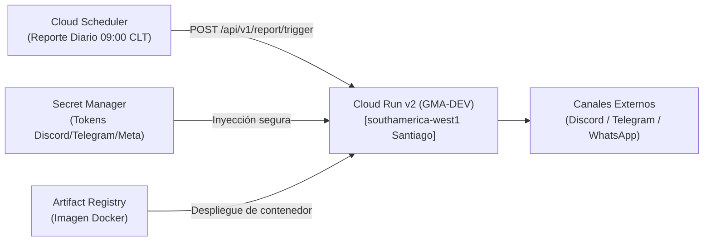

# Despliegue en Google Cloud Platform (GCP) con Terraform

Esta guía detalla el despliegue de **GMA-DEV** en la nube de Google utilizando **Terraform** como herramienta de Infraestructura como Código (IaC).

---

## 1. Arquitectura en GCP

El despliegue en GCP utiliza servicios administrados sin servidor (*serverless*) diseñados para maximizar la resiliencia y minimizar costos:



* **Google Cloud Run v2:** Ejecuta el contenedor con escalado automático a cero cuando no hay peticiones, en la región de **Santiago de Chile (`southamerica-west1`)**.
* **Google Secret Manager:** Almacena los tokens de Discord y Telegram de forma cifrada en reposo. Cloud Run los inyecta como variables de entorno seguras en tiempo de ejecución.
* **Google Cloud Scheduler:** Invoca el endpoint `/api/v1/report/trigger` a las 09:00 CLT todos los días.
* **Google Artifact Registry:** Repositorio privado para almacenar la imagen Docker construida.

---

## 2. Requisitos Previos

1. Una cuenta activa en Google Cloud y un proyecto creado (ej. `mi-empresa-ops`).
2. Google Cloud SDK (`gcloud` CLI) instalado y autenticado:
   ```bash
   gcloud auth login
   gcloud auth application-default login
   ```
3. Terraform instalado (versión `>= 1.5.0`).
4. Docker instalado en tu máquina para construir la imagen inicial.

---

## 3. Paso a Paso para el Despliegue

### Paso 1: Configurar el proyecto y habilitar APIs
Configura tu proyecto en la terminal:
```bash
gcloud config set project TU_PROJECT_ID
```

Habilita las APIs necesarias de Google Cloud:
```bash
gcloud services enable \
  run.googleapis.com \
  secretmanager.googleapis.com \
  artifactregistry.googleapis.com \
  cloudscheduler.googleapis.com
```

---

### Paso 2: Crear el repositorio de imágenes y subir el contenedor
Crea el repositorio en Artifact Registry en la región de Santiago:
```bash
gcloud artifacts repositories create gma-dev-repo \
  --repository-format=docker \
  --location=southamerica-west1 \
  --description="Repositorio Docker para GMA-DEV"
```

Configura Docker para autenticarse contra GCP:
```bash
gcloud auth configure-docker southamerica-west1-docker.pkg.dev
```

Construye la imagen Docker y súbela a tu Artifact Registry:
```bash
# Navega a la raíz del repositorio
cd d:\Docs\Repos\GMA-DEV

# Construir imagen con tag de Artifact Registry
docker build -t southamerica-west1-docker.pkg.dev/TU_PROJECT_ID/gma-dev-repo/gma-dev:latest .

# Subir imagen
docker push southamerica-west1-docker.pkg.dev/TU_PROJECT_ID/gma-dev-repo/gma-dev:latest
```

---

### Paso 3: Configurar las variables de Terraform
Entra a la carpeta de Terraform para GCP:
```bash
cd infra/terraform/gcp
```

Crea un archivo `terraform.tfvars` con tus parámetros (este archivo está ignorado en `.gitignore` para no filtrar datos):
```hcl
project_id             = "TU_PROJECT_ID"
region                 = "southamerica-west1"
container_image        = "southamerica-west1-docker.pkg.dev/TU_PROJECT_ID/gma-dev-repo/gma-dev:latest"
telegram_chat_id       = "987654321"
monitored_targets_json = "[{\"name\":\"API Produccion\",\"url\":\"https://api.tuempresa.cl/healthz\",\"interval_seconds\":60,\"expected_status\":200}]"
```

---

### Paso 4: Inicializar y Aplicar Terraform
Inicializa los proveedores:
```bash
terraform init
```

Verifica el plan de ejecución:
```bash
terraform plan
```

Aplica los cambios en GCP:
```bash
terraform apply
```
*(Escribe `yes` cuando se te solicite confirmación).*

---

### Paso 5: Cargar los Secretos en Secret Manager
Una vez que Terraform crea los recursos de Secret Manager, almacena los valores reales de tus tokens sin que toquen archivos de texto:

```bash
# Guardar Webhook de Discord
echo -n "https://discord.com/api/webhooks/TU_WEBHOOK_URL" | \
  gcloud secrets versions add ops-sentinel-discord-webhook --data-file=-

# Guardar Token de Telegram
echo -n "7123456789:ABCdefGhIJKlmNoPQRstuVWXyz" | \
  gcloud secrets versions add ops-sentinel-telegram-token --data-file=-
```

---

### Paso 6: Verificar el Despliegue
Al finalizar, Terraform mostrará el output con la URL pública asignada por Cloud Run:
```bash
Outputs:
cloud_run_url = "https://ops-sentinel-xyz-uc.a.run.app"
```

Prueba la salud del servicio:
```bash
curl https://ops-sentinel-xyz-uc.a.run.app/healthz
```

Respuesta esperada:
```json
{
  "status": "healthy",
  "active_channels": ["discord", "telegram"],
  "ley_21663_compliance": true
}
```
