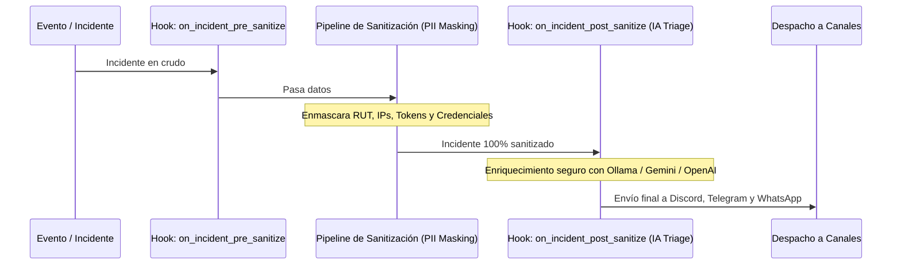

# Guía de Extensibilidad: Plugins Personalizados & Enriquecimiento con IA

**GMA-DEV** cuenta con una arquitectura abierta y desacoplada basada en el patrón de ciclo de vida de plugins (*lifecycle hooks*). Esto te permite añadir filtros propios, enriquecer alertas con Inteligencia Artificial, o conectar nuevos canales de salida sin alterar el código central.

---

## 1. Arquitectura del Ciclo de Vida de Plugins

Los plugins interactúan con los eventos del sistema a través de tres puntos de intercepción definidos en [`src/plugins/base.py`](../../src/plugins/base.py):



---

## 2. Cómo Crear un Plugin Personalizado

Para crear un nuevo plugin, solo debes heredar de `BasePlugin` e implementar los métodos que necesites:

### Ejemplo: Plugin de Notificación Interna o Filtrado
Crea un archivo en `src/plugins/custom_filter.py`:

```python
import logging
from src.core.models import Incident, AlertSeverity
from src.plugins.base import BasePlugin

logger = logging.getLogger("CustomFilterPlugin")

class LowPriorityFilterPlugin(BasePlugin):
    """Filtra alertas de servicios no críticos durante la noche."""

    @property
    def name(self) -> str:
        return "low_priority_filter"

    async def on_incident_post_sanitize(self, incident: Incident) -> Incident:
        # Si el servicio es secundario y la severidad es solo WARNING, añade una etiqueta
        if "test" in incident.service_name.lower() and incident.severity == AlertSeverity.WARNING:
            incident.title = f"[NON-URGENT] {incident.title}"
            logger.info(f"Marcado como no urgente: {incident.id}")
            
        return incident
```

### Registrar el Plugin en `src/main.py`:
```python
from src.plugins.base import plugin_manager
from src.plugins.custom_filter import LowPriorityFilterPlugin

# Registrar al inicio
plugin_manager.register(LowPriorityFilterPlugin())
```

---

## 3. Enriquecimiento de Incidentes con IA (`AIEnricherPlugin`)

GMA-DEV incluye de fábrica el plugin [`src/plugins/ai_enricher.py`](../../src/plugins/ai_enricher.py), que analiza incidentes en tiempo real para generar un diagnóstico conciso de 2 líneas y una acción inmediata recomendada para el SysAdmin de guardia.

> [!IMPORTANT]
> **Privacidad Garantizada:** El plugin de IA se ejecuta estrictamente en el hook `on_incident_post_sanitize`. Esto significa que **ningún RUT, dirección IP pública de clientes, correo o token es enviado a los modelos de lenguaje**, cumpliendo con la legislación de datos personales.

---

### Opción A: Ollama (100% Local y Offline - Cero Dependencia Externa)

Esta es la opción más segura para entornos corporativos o cuando no se desea pagar por tokens de API.

1. Levanta el contenedor con perfil de IA:
   ```bash
   docker compose --profile ai up -d
   ```
2. Descarga el modelo `llama3.2` (3 billones de parámetros, rápido y eficiente):
   ```bash
   docker exec -it gma-dev-ollama ollama pull llama3.2
   ```
3. En tu archivo `.env`:
   ```dotenv
   AI_ENRICHER_ENABLED=true
   AI_PROVIDER=ollama
   OLLAMA_BASE_URL=http://localhost:11434
   OLLAMA_MODEL=llama3.2
   ```

---

### Opción B: Google Gemini API (Nivel Gratuito / Alta Velocidad)

1. Obtén tu API Key gratuita en [Google AI Studio](https://aistudio.google.com/).
2. En tu archivo `.env`:
   ```dotenv
   AI_ENRICHER_ENABLED=true
   AI_PROVIDER=gemini
   GEMINI_API_KEY=AIzaSy...tu_clave_aqui
   ```

---

### Opción C: OpenAI API

1. Obtén tu API Key en [platform.openai.com](https://platform.openai.com/).
2. En tu archivo `.env`:
   ```dotenv
   AI_ENRICHER_ENABLED=true
   AI_PROVIDER=openai
   OPENAI_API_KEY=sk-...tu_clave_aqui
   ```

---

## 4. Cómo Añadir Nuevos Canales de Notificación (ej. Slack o Email)

Para agregar un canal adicional (por ejemplo Slack):
1. Hereda de `NotificationChannel` ([`src/integrations/channels/base.py`](../../src/integrations/channels/base.py)):
   ```python
   from src.integrations.channels.base import NotificationChannel
   from src.core.models import Incident, ReportSummary

   class SlackChannel(NotificationChannel):
       @property
       def name(self) -> str:
           return "slack"

       async def send_incident(self, incident: Incident) -> bool:
           # Tu lógica de HTTP POST a la API o Webhook de Slack
           return True

       async def send_report(self, report: ReportSummary) -> bool:
           # Tu lógica de reporte periódico a Slack
           return True
   ```
2. Agrégalo a la lista `active_channels` en [`src/main.py`](../../src/main.py).
